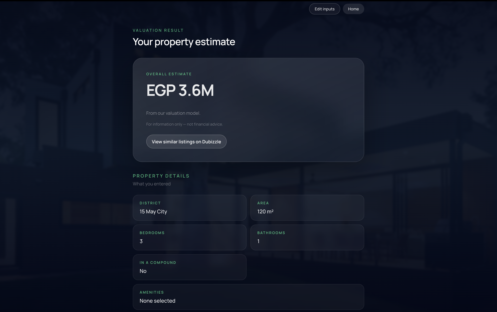

# Makanak 🏠

Machine learning-powered real estate valuation platform for the Egyptian market.

Makanak predicts apartment prices using a trained machine learning model, allowing users to estimate their property's value based on location, size, amenities, and other key features. The platform also generates similar Dubizzle listings for quick market comparison.

### 🌐 Live app

**<https://makanak-five.vercel.app>**

The API is served from the same origin under `/api` — for example
<https://makanak-five.vercel.app/api/health>.

---

## 📸 Screenshots

### Hero Section

<p align="center">
  
</p>

### Property Details Form

<p align="center">
  
</p>

### Property Valuation Result

<p align="center">
  
</p>

### User Authentication

<p align="center">
  
</p>

---

## 🚀 Features

- 🤖 Machine learning-powered property price prediction
- 🏠 Multi-step property valuation form
- 🔐 User authentication (Sign up / Login)
- 💾 Save and manage previous valuations
- 🔍 Generate similar property listings on Dubizzle
- 🌍 Modern responsive React interface
- ⚡ RESTful Flask API

---

## 🧠 Machine Learning

The valuation engine is built using **HistGradientBoostingRegressor** from Scikit-learn.

### Model Highlights

- HistGradientBoostingRegressor
- Log-transformed target variable
- Feature engineering
- One-Hot Encoding for categorical features
- Monotonic constraints
- 5-Fold Cross Validation

### Features Used

- Area
- Bedrooms
- Bathrooms
- District
- Compound Status
- Amenities
- Engineered features (room density, amenity density, etc.)

---

## 🛠 Tech Stack

### Backend

- Flask
- Scikit-learn
- SQLite (local development) / PostgreSQL — Neon (production)
- Joblib
- Pandas
- NumPy

### Frontend

- React (Vite)
- Fetch API
- CSS

---

## 📁 Project Structure

```text
Makanak/
│
├── makanak/          # React Frontend (Vite)
├── makanak-api/      # Flask Backend + ML Model
├── vercel.json       # Vercel Services config (frontend + API in one project)
└── README.md
```

---

# ⚙ Backend Setup

## 1. Navigate to backend

```bash
cd makanak-api
```

## 2. Create virtual environment

```bash
python3 -m venv .venv
```

## 3. Activate environment

### macOS / Linux

```bash
source .venv/bin/activate
```

### Windows

```bash
.venv\Scripts\activate
```

## 4. Install dependencies

```bash
pip install -r requirements.txt
```

If the requirements file is unavailable:

```bash
pip install flask joblib scikit-learn pandas numpy
```

## 5. Configure environment variables

```bash
cp .env.example .env
```

Leave `DATABASE_URL` empty to use the local SQLite file at `makanak-api/app.db`.
Set it to a PostgreSQL connection string to run against Postgres instead.

## 6. Run the backend

```bash
python app.py
```

Backend runs on:

```
http://127.0.0.1:5050
```

---

# 💻 Frontend Setup

## 1. Navigate to frontend

```bash
cd makanak
```

## 2. Install packages

```bash
npm install
```

## 2b. Configure environment variables

```bash
cp .env.example .env
```

`VITE_API_URL` must use the same hostname you open in the browser
(`localhost` vs `127.0.0.1`) so the session cookie is sent.

## 3. Start development server

```bash
npm run dev
```

Frontend runs on:

```
http://localhost:5173
```

---

# 🔗 API Endpoints

Paths below are relative to the API root: `http://localhost:5050` in local
development, and `/api` in production (e.g. `/api/predict`).

## Authentication

| Method | Endpoint |
|--------|----------|
| POST | `/auth/signup` |
| POST | `/auth/login` |
| POST | `/auth/logout` |
| GET | `/auth/me` |

## Prediction

| Method | Endpoint |
|--------|----------|
| POST | `/predict` |

## Saved Valuations

| Method | Endpoint |
|--------|----------|
| GET | `/valuations` |
| GET | `/valuations/:id` |

---

# 🧪 Example Prediction Request

```json
{
  "area_sqm": 190,
  "bedrooms": 3,
  "bathrooms": 2,
  "amenities_count": 6,
  "location_text": "Sheikh Zayed",
  "district": "Sheikh Zayed",
  "type": "Apartment",
  "ownership": "Primary",
  "furnished": "Yes",
  "payment_option": "Cash",
  "completion_status": "Ready"
}
```

---

# 🔍 Similar Listings

After every valuation, Makanak automatically generates a Dubizzle search URL using:

- Predicted price ±500,000 EGP
- Area ±20 m²
- Same district
- Same number of bedrooms
- Same number of bathrooms

This allows users to compare their estimated property value with current market listings.

---

# ☁️ Deployment (Vercel)

The frontend and the Flask API are deployed as **two services inside a single
Vercel project**, so they share one origin and one domain. That keeps the Flask
session cookie first-party: no cross-site cookies, no CORS in production.

Routing is defined in [`vercel.json`](vercel.json):

| Request | Served by |
|---------|-----------|
| `/api/*` | `makanak-api/` — Flask on the Python runtime |
| everything else | `makanak/dist` — the built React app |

Vercel passes the original path through to the service, so the API receives
`/api/predict`. A small WSGI wrapper in `app.py` strips the `API_PATH_PREFIX`
before routing, which is why the same code serves `/predict` locally and
`/api/predict` in production.

## Continuous deployment

The Vercel project `makanak` is connected to this GitHub repository. Every push
to `main` triggers a production deployment; pushes to other branches and pull
requests create preview deployments.

## Environment variables

Set these in **Vercel → Project → Settings → Environment Variables**. Local
templates with placeholder values are in `makanak-api/.env.example` and
`makanak/.env.example`.

| Variable | Scope | Purpose |
|----------|-------|---------|
| `FLASK_SECRET_KEY` | API | Signs the session cookie. Required in production — the app refuses to start without it. |
| `DATABASE_URL` | API | PostgreSQL connection string. Provided automatically by the Neon integration. When unset, the API falls back to local SQLite. |
| `API_PATH_PREFIX` | API | Path the API is mounted under. Defaults to `/api`. |
| `CORS_ORIGINS` | API | Comma-separated origins allowed to send credentialed requests. Empty in production (same origin); defaults to the Vite dev server locally. |
| `SESSION_COOKIE_SECURE` | API | HTTPS-only cookie. Defaults to on when deployed, off locally. |
| `VITE_API_URL` | Frontend | API base URL baked in at build time. `makanak/.env.production` sets it to `/api`. |

Never commit real values: `.env` and `.env.local` are gitignored, and only
`.env.example` / `.env.production` (placeholders and public config) are tracked.

## Database

Production uses **Neon Postgres** (free tier) provisioned through the Vercel
Marketplace. `makanak-api/db.py` targets both backends from one interface and
creates its tables on first use, so no manual migration step is needed.

Local development needs no database server — leave `DATABASE_URL` unset and the
API writes to `makanak-api/app.db`.

## Serverless notes

- The model bundle is loaded from an absolute path at import time, so it is
  warm for subsequent requests on the same instance.
- `scikit-learn` is pinned to **1.8.0**, the version the model was serialized
  with. Changing it risks loading warnings or different predictions.
- Notebooks, datasets and dev-only dependencies are excluded from the function
  bundle (`excludeFiles` in `vercel.json`, `requirements-dev.txt`).
- The filesystem is ephemeral and read-only in practice — nothing is written to
  disk at runtime.


---

# 📌 Notes

- This project was developed for academic purposes.
- Data was collected from publicly available Dubizzle apartment listings.
- Predictions represent estimated market values and should not be considered professional financial advice.
